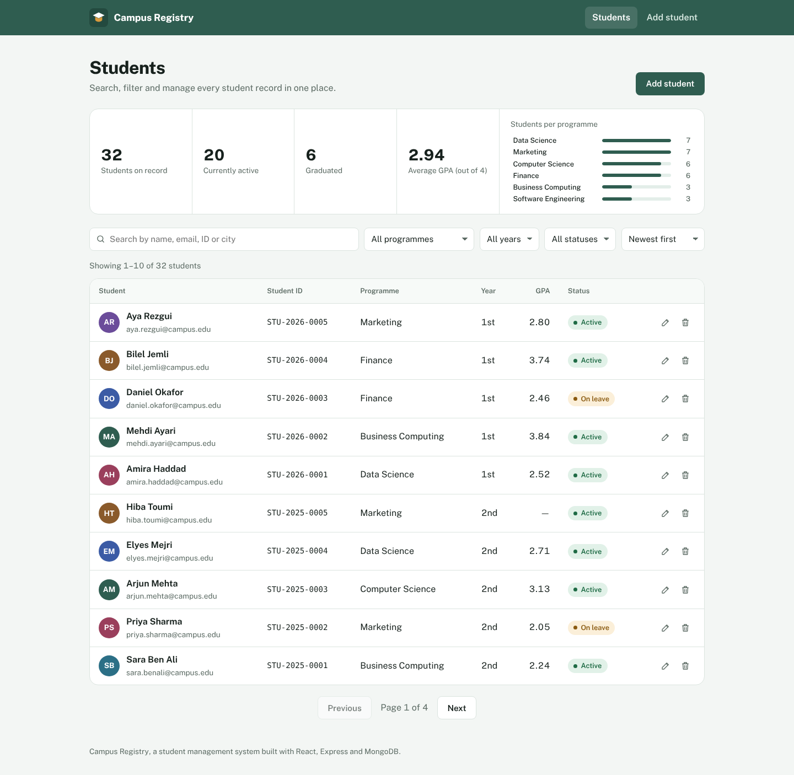

# Campus Registry: Student Management System

**Auspify Full Stack Development Internship, Task 2 (Easy)**
Ghassen Jdidi, November 2026

A full-stack application for a school office to manage student records: add, update, delete and view students, with search, filters, sorting and pagination. React on the front end, a REST API in Node.js and Express, and MongoDB for storage.



## Features

| Auspify key feature | What it does |
| --- | --- |
| Add students | A grouped form (personal, contact, academic) with validation on both client and server. Each new student gets a readable ID such as `STU-2026-0007`. |
| Update records | The same form pre-filled. The student ID never changes, and the email stays unique. |
| Delete records | From the list or the profile, always after a confirmation dialog. |
| View student details | A profile page with a student-card view and every field grouped by topic. |

Also included:

- Search across name, email, student ID and city, where every word must match ("sara ben" finds Sara Ben Ali).
- Filters for programme, year and status, plus six sort orders. Filters live in the URL, so a filtered list can be bookmarked or shared.
- A summary strip: students on record, active, graduated, average GPA, and students per programme (click a bar to filter).
- Clear empty, loading and error states, toasts after every change, and a layout that turns the table into cards on phones.

## Tech stack

- **Front end**: React 19, React Router 7, Vite, plain CSS
- **Back end**: Node.js 20+, Express 5, Mongoose 9
- **Database**: MongoDB (local or MongoDB Atlas)
- **Security and quality**: Helmet headers, rate limiting, input whitelisting, regex escaping for search, central error handler
- **Tests**: Jest and Supertest (21 API tests)

## Project structure

```
Task2-Student-Management-System/
├── package.json                 scripts that run both apps
├── server/
│   ├── src/
│   │   ├── app.js               Express app (middleware, routes, serves the React build in production)
│   │   ├── server.js            connects to MongoDB and starts listening
│   │   ├── config/db.js
│   │   ├── models/              Student, Counter (atomic sequence for student IDs)
│   │   ├── controllers/         studentController.js (list, stats, CRUD)
│   │   ├── routes/              studentRoutes.js
│   │   ├── middleware/          errorHandler.js (validation, duplicate keys, bad ids, bad JSON)
│   │   └── utils/ApiError.js
│   ├── seed/seed.js             32 demo students
│   ├── tests/                   students.test.js
│   └── .env.example
├── client/
│   └── src/
│       ├── api.js               fetch wrapper
│       ├── pages/               StudentsPage, StudentDetailPage, StudentFormPage, NotFoundPage
│       ├── components/          Layout, ConfirmDialog, Toast, shared bits
│       ├── hooks/               useMeta (option lists), useDebounce
│       └── styles.css
└── screenshots/
```

## Run it locally

You need **Node.js 20 or newer** and **MongoDB** (install MongoDB Community Server, or create a free cluster on MongoDB Atlas).

```bash
cd Task2-Student-Management-System
npm run install-all                    # installs root, server and client packages
cp server/.env.example server/.env     # then set MONGO_URI if you use Atlas
npm run seed                           # loads 32 demo students
npm run dev                            # API on :5000 and React on :5173
```

Open http://localhost:5173.

To run it the way it runs in production (one server, one port):

```bash
npm run build      # builds the React app into client/dist
npm start          # Express serves the API and the built app on http://localhost:5000
```

## REST API

Base URL: `/api`

| Method | Endpoint | Description |
| --- | --- | --- |
| GET | `/health` | API and database status |
| GET | `/students` | List students. Query: `search`, `programme`, `year`, `status`, `sort` (`newest`, `oldest`, `name`, `gpa-desc`, `gpa-asc`, `year`, `id`), `page`, `limit` |
| GET | `/students/stats` | Totals, average GPA and students per programme |
| GET | `/students/meta` | Allowed programmes, statuses, genders and years |
| GET | `/students/:id` | One student |
| POST | `/students` | Create a student |
| PUT | `/students/:id` | Update a student |
| DELETE | `/students/:id` | Delete a student |

Errors always come back as `{ "message": "...", "errors": { "field": "message" } }` with the right status code: 400 for invalid data or ids, 404 for missing records, 409 for a duplicate email.

Example:

```bash
curl -X POST http://localhost:5000/api/students \
  -H "Content-Type: application/json" \
  -d '{"firstName":"Sara","lastName":"Ben Ali","email":"sara@campus.edu","programme":"Finance","year":2,"gpa":3.4}'
```

## Tests

```bash
npm test
```

The 21 tests start a throwaway in-memory MongoDB (downloaded automatically the first time) and cover: creating students and ID generation, required and invalid fields, duplicate emails, ignored server-only fields, pagination, multi-word search, regex safety, combined filters, sorting, statistics, 404 and 400 handling, updates, clearing optional fields and deletion. To run them against your own MongoDB instead, set `MONGO_URI_TEST=mongodb://127.0.0.1:27017`.

The full browser flow (add with validation errors, duplicate email, edit, search, filter, delete with confirmation, not-found page, phone layout) was also tested end to end, which produced the screenshots below.

## Deploy (free)

1. **Database**: create a free M0 cluster on MongoDB Atlas, add a database user, allow access from anywhere (`0.0.0.0/0`), and copy the connection string.
2. **App**: on Render, create a new Web Service from the GitHub repository.
   - Build command: `npm run install-all && npm run build`
   - Start command: `npm start`
   - Environment variables: `MONGO_URI` (your Atlas string), `NODE_ENV=production`
3. Once it's live, open the Render shell and run `npm run seed` if you want the demo data online.

## How the Auspify workflow was followed

1. **Design the frontend interface**: list, profile and form pages with a consistent design system.
2. **Create backend APIs**: REST endpoints in Express with controllers and routes kept separate.
3. **Implement database connectivity**: Mongoose models, schema validation, unique and secondary indexes.
4. **Add CRUD operations**: create, read (list and detail), update and delete, from the API to the UI.
5. **Test application functionality**: 21 automated API tests plus an end-to-end browser run.

## Screenshots

| File | Shows |
| --- | --- |
| `01-student-list.png` | List with summary, filters and table |
| `02-search-and-filters.png` | Filtered and sorted list |
| `03-student-profile.png` | Student profile right after adding a student |
| `04-edit-student.png` | Edit form |
| `05-form-validation.png` | Validation messages on an empty form |
| `06-delete-confirmation.png` | Confirmation before deleting |
| `07-mobile-list.png` | Phone layout |
